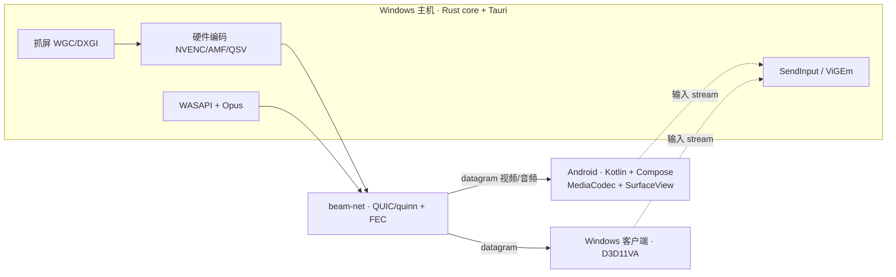
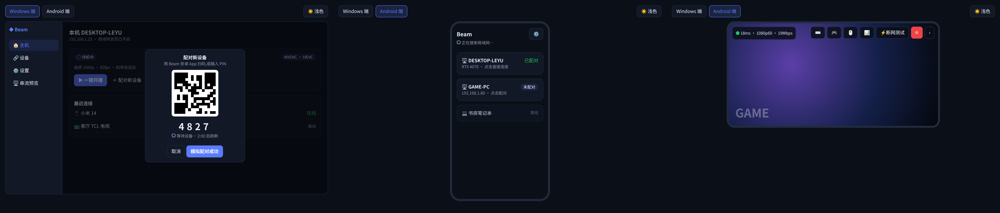

# Beam

> A clean-room, Rust-powered game & desktop streaming app for Windows hosts and Windows/Android clients — one installer, scan to connect.

**Beam** 是一个用 Rust 从头实现的游戏/桌面串流工具,定位为 Sunshine + Moonlight 的易用替代:Windows 电脑做主机,手机、平板、电视和另一台 Windows 电脑做客户端。

> ⚠️ **当前状态:设计阶段,尚无代码。** 本仓库目前只包含产品方案、技术设计文档与交互原型。

## 特性与差异化
- **单安装包、零网页后台**:主机端是原生桌面 App(Tauri),托盘一键开播。
- **扫码即连**:二维码 / PIN 配对(TLS 1.3 + 证书指纹固定 + SPAKE2)。
- **内置虚拟显示器、虚拟手柄、音频**(v1),无需额外插件。
- **内置分段延迟诊断**:抓屏、编码、网络、解码、显示逐段可见;另有仅 Debug 构建的性能统计模块。
- **中文优先**,适配国产安卓手机、平板与电视。
- **净室实现**,MIT OR Apache-2.0 双协议。

## 性能目标(设计目标,未实测)
千兆有线局域网,HEVC:

| 档位 | 码率 | 线上占用(含 FEC 与协议开销) | 端到端目标 | 评估 |
|---|---|---|---|---|
| 1080p 60 | 20–40 Mbps | — | ≤30 ms | MVP 基线 |
| 4K 60 | 80–150 Mbps | 100–186 Mbps | 16–27 ms | 可达到 |
| 1440p 165 | 100–200 Mbps | 124–248 Mbps | 8–14 ms | 有条件(需 165Hz 客户端屏) |
| 1080p 200 | 80–150 Mbps | 100–186 Mbps | 7–11 ms | Windows 客户端有条件;Android 受屏幕刷新率限制 |

依据与前提见 [产品方案 §10](docs/beam-product-plan.md#10-高帧率性能评估)。

## 架构概览

Android 通过 uniffi 复用 Rust 的 proto / net / pair / discovery,解码与渲染留在 Kotlin。

## 技术栈
| 层 | 选型 |
|---|---|
| Windows 主机/客户端 | Rust、Tauri 2、windows-capture、ffmpeg-next(LGPL 动态链接)、WASAPI、Opus、vigem-client |
| Android 客户端 | Kotlin、Jetpack Compose、MediaCodec、SurfaceView、AAudio、CameraX + ML Kit |
| 网络与安全 | QUIC(quinn)、datagram + Reed-Solomon FEC、rustls、rcgen、SPAKE2、mDNS(mdns-sd) |
| 跨端绑定 | uniffi + cargo-ndk |

## 路线图
- **MVP**:Windows 主机 → Android/Windows 客户端,局域网 1080p60,键鼠/触控,mDNS,扫码/PIN。
- **v1**:音频、手柄、虚拟显示器、FEC + 自适应码率、断线重连、Android TV、GameStream 兼容层、4K60 达标、高帧率档(NVENC)、Debug 性能统计。
- **v2**:HDR、AV1、Android 120fps+、多显示器、剪贴板、WOL、外网。

## 文档
- [产品与技术方案](docs/beam-product-plan.md)
- [技术设计文档](docs/beam-tech-design.md)
- [交互原型](docs/prototype/interactive.html)(下载后用浏览器打开)
- 原型截图:[docs/images](docs/images)

## 许可证
可任选以下之一:
- MIT License([LICENSE-MIT](LICENSE-MIT))
- Apache License 2.0([LICENSE-APACHE](LICENSE-APACHE))

Copyright 2026 Beam contributors.

Beam 是净室实现,不包含也不衍生自 Sunshine / Moonlight 等 GPL 项目的代码。FFmpeg 仅以 LGPL 构建动态链接。除非另有声明,你有意提交的贡献将按上述双协议授权,不附加额外条款。
