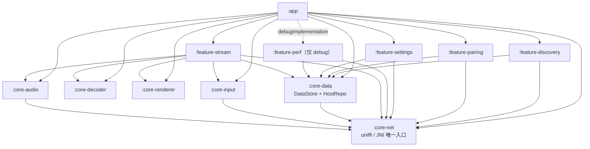

# Beam Android

Beam 串流的 Android 客户端（手机 / 平板 / TV）。Windows 主机 → Android 客户端的
局域网串流；协议 / FEC / 配对 / 发现复用 Rust 侧（`beam-ffi` 经 uniffi），
**解码与渲染留在 Kotlin**（MediaCodec + SurfaceView）。

> 唯一权威依据：`docs/beam-tech-design.md` §2 工程结构、§3.11 命令与事件、
> **§3.12 Android 模块表**、§3.13 perf 门控。
> 配套阅读：`docs/beam-product-plan.md`（§7 Android 模块结构、§16 设计规范）、
> `docs/prototype/interactive.html`（Android 端 5 个页面流程）。

---

## 1. 构建方式

```bash
cd android

# Debug APK
./gradlew :app:assembleDebug          # 产物: app/build/outputs/apk/debug/app-debug.apk

# Release APK（开启 R8/minify）
./gradlew :app:assembleRelease        # 产物: app/build/outputs/apk/release/app-release-unsigned.apk

# 单元测试
./gradlew test                        # 等价于所有模块的 testDebugUnitTest + testReleaseUnitTest

# 单模块
./gradlew :core-net:compileDebugKotlin
./gradlew :core-data:testDebugUnitTest
```

### 环境要求（与本机一致）

| 项 | 版本 / 路径 |
|---|---|
| JDK | 21 |
| Gradle | 8.13（由 wrapper 固定，见 `gradle/wrapper/gradle-wrapper.properties`） |
| AGP | 8.11.1 |
| Kotlin | 2.1.21（Compose 编译器插件用 `org.jetbrains.kotlin.plugin.compose`） |
| Compose BOM | 2025.06.00 |
| compileSdk / targetSdk | 36 |
| buildToolsVersion | 36.0.0 |
| minSdk | 26 |
| Android SDK | 本机位于 `D:\Program Files\Android\SDK`（写进 `local.properties`，该文件不入库） |

> `local.properties` 不入库。CI 上用 `ANDROID_HOME` 环境变量即可。

---

## 2. 模块树与依赖图

12 个 Gradle 模块，严格对应 §3.12 的「Android 模块」表：

```
android/
├─ app/                    导航、主题、权限、TV 入口
├─ feature-discovery/      主机列表、NSD 兜底
├─ feature-pairing/        CameraX + ML Kit 扫码、PIN 键盘
├─ feature-stream/         SurfaceView、悬浮工具栏、统计浮层
├─ feature-settings/       设置页
├─ feature-perf/           性能面板（仅 debugImplementation）
├─ core-decoder/           MediaCodec 异步、KEY_LOW_LATENCY、厂商 low_latency 解码器、output fence
├─ core-renderer/          Surface 管理、Surface.setFrameRate、帧节奏
├─ core-input/             触控/手柄/遥控映射为 InputEvent
├─ core-audio/             Opus 解码 + AAudio
├─ core-data/              DataStore 设置、信任主机 HostRepo
└─ core-net/               uniffi 绑定 BeamClient、回调转 Flow
```



依赖规则（§4「只允许上层依赖下层」）：

* `:core-net` 是**唯一**允许触碰 JNI / `System.loadLibrary` 的模块；
* `:core-decoder` / `:core-renderer` **不依赖任何项目模块**（§3.12 禁止网络、禁止解码细节外泄）；
* `:core-input` / `:core-audio` 只依赖 `:core-net`（取 `InputEvent` / `AudioPacket` 协议模型）；
* `:feature-*` 一律经 `:core-net` 访问 Rust 能力，**禁止直接调 JNI**；
* `:app` 只做导航 / 主题 / 权限 / TV 入口，**不含业务逻辑**。

---

## 3. §3.12 模块表对照与「禁止」事项落实

| 模块 | 职责 | 对外接口（Kotlin） | 禁止事项 → 落实方式 |
|---|---|---|---|
| `:app` | 导航、主题、权限、TV 入口 | `MainActivity` / `TvMainActivity` / `BeamNavHost` | 业务逻辑 → 只做装配与路由，逻辑下沉到 `feature-*` / `core-*` |
| `:feature-discovery` | 主机列表、NSD 兜底 | `DiscoveryViewModel` | 直接调 JNI → 只经 `BeamClient.discover()`；NSD 兜底用 Kotlin `NsdManager`（§3.4 允许） |
| `:feature-pairing` | CameraX+ML Kit 扫码、PIN 键盘 | `PairingViewModel` | —（扫码链路必须经 `:core-net` 的 `pairQr`/`pairPin`） |
| `:feature-stream` | SurfaceView、悬浮工具栏、统计浮层 | `StreamScreen` | 解码细节 → 只依赖 `:core-decoder` 的 `VideoDecoder` 接口，不碰 `MediaCodec` |
| `:feature-settings` | 设置页 | `SettingsScreen` / `SettingsViewModel` | — |
| `:feature-perf` | 性能面板 | `PerfPanel` | 被 release 依赖 → 仅 `debugImplementation`，release 依赖图中不存在 |
| `:core-decoder` | MediaCodec 异步、低延迟、厂商解码器白名单、output fence | `interface VideoDecoder { fun start(surface, fmt); fun queue(frame, ptsUs, key); fun stop() }` | 网络 → 不依赖 `:core-net`，无任何 IO 代码 |
| `:core-renderer` | Surface 管理、`Surface.setFrameRate`、帧节奏 | `FramePacer` / `SurfaceFrameRate` | —（不依赖解码器与网络层） |
| `:core-input` | 触控/手柄/遥控 → `InputEvent` | `InputMapper` | —（`InputEvent` 定义在 `:core-net`，字段与 `beam-proto` 对齐） |
| `:core-audio` | Opus 解码 + AAudio | `AudioPlayer` | — |
| `:core-data` | DataStore 设置、信任主机 | `SettingsRepo` / `HostRepo` | — |
| `:core-net` | uniffi 绑定、回调转 Flow | `interface BeamClient { suspend fun connect(peer: Peer, cfg: StreamCfg): Session }` | —（**唯一**允许 JNI 的模块） |

每个模块另有一份 `README.md`，写明本模块职责与对应 §3.12 行的「禁止」事项。

---

## 4. uniffi 接入步骤（Rust → Android）

详见 **`core-net/README.md`**（含命令、类名契约、异常语义、内存所有权）。摘要：

```bash
# 1) 工具
cargo install uniffi-bindgen
cargo install cargo-ndk

# 2) 生成 Kotlin 绑定 → android/core-net/src/main/java/dev/beam/core/net/uniffi/
uniffi-bindgen generate --library target/release/libbeam_ffi.so \
    --language kotlin --out-dir android/core-net/src/main/java/dev/beam/core/net/uniffi

# 3) 交叉编译原生库 → android/core-net/src/main/jniLibs/{arm64-v8a,x86_64}/
cargo ndk -t arm64-v8a -t x86_64 -o android/core-net/src/main/jniLibs \
    build --release -p beam-ffi
```

要点：

* **生成物缺席时工程仍可编译**——所有交互走 `NativeBeamBridge` 的反射适配层；
  运行时缺 `.so` 或缺生成类会抛 `BeamNativeUnavailableException`（带可读修复指引），
  而不是静默失败或 `ClassNotFoundException`；
* **热路径**帧数据用 JNI `DirectByteBuffer` + `ByteBufferPool` 池化（§6 内存所有权）；
  **控制面**（`SessionEvent` / 配对结果 / 发现结果）走 uniffi 对象；
* `jniLibs/{arm64-v8a,x86_64}/` 目前只有占位说明文件，**没有伪造的 `.so`**。

---

## 5. debug / release 的 perf 门禁差异（§3.13 / §7）

| 维度 | debug | release |
|---|---|---|
| `:feature-perf` 依赖 | `debugImplementation(project(":feature-perf"))` | **不在依赖图里** |
| `BuildConfig.PERF_STATS` | `true` | `false` |
| perf 面板入口 | `app/src/debug/.../perf/PerfEntry.kt`（真实 `PerfPanel`） | `app/src/release/.../perf/PerfEntry.kt`（空实现） |
| `perf://tick` 事件 | 250 ms | 不存在 |
| 代码压缩 | `isMinifyEnabled = false` | `isMinifyEnabled = true` + `isShrinkResources = true` |

**可执行校验**（§7 要求的 release 无 perf 符号检查）：

```bash
./gradlew :app:assembleRelease
unzip -l app/build/outputs/apk/release/app-release-unsigned.apk \
  | grep -i "feature-perf\|feature/perf\|perfstats\|PerfPanel" && echo "FAIL: release 含 perf 类" || echo "PASS: release 无 perf 类"
```

> 原理：`feature-perf` 只挂在 `debugImplementation` 上，release 变体根本没有这条依赖，
> R8 再做一次兜底裁剪，因此 release APK 里不存在任何 perf 相关类。

---

## 6. 事件语义（§3.11）

Android 侧消费的控制面事件与桌面端对齐：

| 事件 | 频率 | Android 消费点 |
|---|---|---|
| `session://stats` | 500 ms | `:feature-stream` 统计浮层（`Session.stats` Flow） |
| `session://reconnecting` | 查询（`Session::reconnecting()`） | `:feature-stream` 断线遮罩（保留最后一帧） |
| `session://disconnected` | 事件 | `:feature-stream` 回退到列表页 |
| `perf://tick` | 250 ms（仅 debug） | `:feature-perf` 面板 |
| `discovery://updated` | 事件 | `:feature-discovery` 主机列表 |
| `pair://request` / `pair://code-rotated` | 事件 | 配对流程 |

---

## 7. 测试

```bash
./gradlew test
```

已有单元测试覆盖：

| 模块 | 测试 |
|---|---|
| `:core-data` | `PeerCodecTest`（信任库编解码）、`SettingsRepoTest`（DataStore 读写与合并） |
| `:core-input` | `InputMapperTest`（触控归一化、摇杆死区、D-pad 映射） |
| `:core-renderer` | `FramePacerTest`（上屏/等待/丢帧/乱序决策） |
| `:core-decoder` | `DecoderSelectorTest`（厂商 low-latency 解码器优选） |
| `:core-audio` | `PcmRingBufferTest`（环形缓冲读写） |
| `:feature-pairing` | `PairPayloadTest`（二维码载荷解析） |

---

## 8. 已知边界

* **未包含原生库与 uniffi 生成物**：`libbeam_ffi.so` 需按 §4 自行构建；
  在此之前 `NativeBeamBridge.isAvailable()` 为 `false`，UI 显示「Rust 侧未接入」而非崩溃。
* **未做真机/模拟器运行验证**：本仓库当前只有单元测试与构建验证，
  没有设备端实测的帧率 / 延迟数据（§8 的 E2E 指标仍待 M2.5 基准）。
* **`android.media.AudioStream`（AAudio 的 Java 侧）在公共 SDK 中不可见**，
  `:core-audio` 因此以 `MediaCodec` 解 Opus、以 `AudioTrack` 为主路径，
  AAudio 走 NDK（`libaaudio.so` + JNI）路径，见 `core-audio/README.md`。
