# Beam 串流:Windows + Android 产品与技术方案

> 用 Rust 净室实现的 Sunshine + Moonlight 替代品:Windows 端 Tauri + Rust 做主机和客户端,Android 端原生 Compose 做客户端。
> 日期:2026-10-29。产品名与所有数值均为方案设定/设计目标,不是实测数据。
> 配套文档:[技术设计文档](beam-tech-design.md)

## 1. 结论
Rust core 写一次,Windows 用 Tauri 直接调,Android 通过 uniffi 复用 proto + net(QUIC)crate,视频解码与渲染留在 Kotlin 侧用 MediaCodec + SurfaceView。MVP 打通 Windows 主机 → Android/Windows 客户端的局域网 1080p60 键鼠/触控串流,自定义 QUIC 协议,GameStream 兼容留到 v1。

## 2. 产品定位
| 项 | 内容 |
|---|---|
| 一句话 | 装一个包、扫一下码,就能把 Windows 电脑的画面串到手机、平板和电视上玩 |
| 目标用户 | 嫌 Sunshine 网页后台复杂的 PC 玩家;用安卓手机/平板/电视玩 PC 游戏的中文用户;需要远程用自己电脑的开发者 |
| 差异化 | 单安装包零网页后台;扫码即连;虚拟显示器、手柄、音频内置;内置分段延迟诊断;中文与国产安卓/电视适配 |
| 竞品 | Sunshine + Moonlight(成熟、GPL、配置复杂);Apollo/Artemis(内置虚拟显示器的分支);punktfunk(Rust/QUIC,早期);moonshine;RustDesk(偏远程桌面) |
| 开源协议 | MIT/Apache-2.0 双协议,净室实现 |

## 3. 核心用户流程
1. **首次启动(Windows)**:安装包可选安装 ViGEmBus/虚拟显示器驱动;启动后自动检测 GPU 与编码器,生成自签证书,主页直接显示二维码与 PIN。
2. **发现**:主机 mDNS 广播 `_beam._udp`;失败时扫码(含 IP、端口、证书指纹、一次性 token)或手动输入 IP。
3. **配对**:扫码用 token + 指纹直接完成,主机弹确认;PIN 走 SPAKE2,双方固定对方证书指纹。之后再连无需输入。
4. **串流**:协商分辨率/帧率/编码(可自动建虚拟显示器匹配客户端分辨率)→ 出画面;客户端有悬浮工具栏和统计浮层。
5. **断线重连**:QUIC 连接迁移覆盖 Wi-Fi 切换;3 秒无帧显示“重连中”并保留最后一帧,30 秒内自动重连并请求 IDR,超时回到列表。
6. **设置**:画质、编码、网络、输入四组,主机与客户端各一份;串流中修改即时重协商。

## 4. 功能清单
| 阶段 | Windows(主机/客户端) | Android(客户端) | 协议/网络 |
|---|---|---|---|
| MVP(2–3 天) | WGC 抓屏 + NVENC/AMF/QSV HEVC;SendInput 键鼠;托盘一键开播;二维码/PIN;Windows 客户端最简版 | 发现列表、扫码/PIN、MediaCodec 硬解、触控转鼠标、基础设置 | QUIC 视频 datagram、控制 stream、mDNS、证书指纹 |
| v1(+3–4 周) | WASAPI 音频 + Opus;ViGEm 手柄;虚拟显示器;延迟诊断浮层;多客户端管理 | 音频、实体手柄、屏幕虚拟手柄、Android TV、统计浮层 | FEC、自适应码率、GameStream 兼容层 |
| v2 | HDR、AV1、多显示器、剪贴板与文件拖放、Wake-on-LAN | 120fps+、HDR、国产机型解码器白名单、平板分屏 | 外网:Tailscale 引导/中继、P2P 打洞 |

## 5. 整体架构
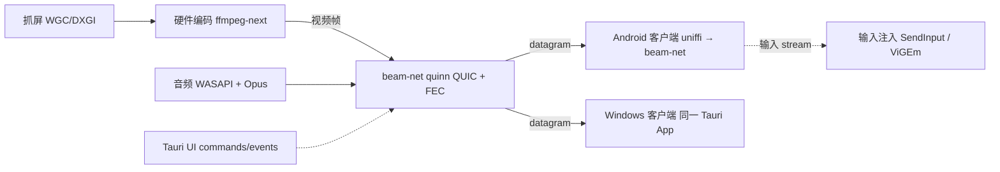
Windows 作为客户端:同一个 Tauri App 切到“连接其他主机”,用 ffmpeg D3D11VA 硬解,渲染用独立原生 D3D11/wgpu 窗口(不走 WebView),UI 只负责列表和浮层。

## 6. Rust workspace 与 Tauri 通信
| crate | 职责 |
|---|---|
| `beam-proto` | 消息定义(postcard/serde)、版本协商、错误码 |
| `beam-net` | quinn 端点、datagram 分片 + FEC、可靠控制/输入 stream、重连、统计 |
| `beam-pair` | 自签证书(rcgen)、指纹固定、SPAKE2 PIN、二维码载荷 |
| `beam-discovery` | mdns-sd 广播与浏览 |
| `beam-capture` | windows-capture(WGC)与 DXGI 回退,输出 D3D11 纹理 |
| `beam-encode` | ffmpeg-next 封装,NVENC/AMF/QSV |
| `beam-audio` | WASAPI loopback + Opus |
| `beam-input` | SendInput 键鼠、vigem-client 手柄 |
| `beam-host` / `beam-client` | 主机/客户端会话编排 |
| `beam-ffi` | uniffi 导出给 Android(只含 proto/net/pair/discovery) |
| `apps/desktop` | Tauri 2 App |

- Commands:`get_host_status`、`start_hosting(opts)`/`stop_hosting`、`get_pairing_code`、`approve_pair(id)`/`remove_device(id)`、`list_hosts`/`connect(host_id)`、`get_settings`/`set_settings(patch)`
- Events:`host://state-changed`、`pair://request`、`discovery://updated`、`session://stats`(500 ms)、`session://disconnected`/`reconnecting`、`pair://code-rotated`
- 视频帧永远不经过 IPC。

## 7. Android 模块结构
| 模块 | 内容 |
|---|---|
| `:app` | Compose 导航、全屏沉浸、TV Leanback 入口 |
| `:feature-discovery` | 主机列表、NsdManager 兜底、WOL |
| `:feature-pairing` | CameraX + ML Kit 扫码、PIN 输入 |
| `:feature-stream` | SurfaceView、悬浮工具栏、统计浮层、触控/手柄映射 |
| `:core-decoder` | MediaCodec 异步、低延迟、厂商解码器白名单 |
| `:core-audio` | Opus 解码 + AAudio |
| `:core-net` | uniffi 绑定 + `libbeam_ffi.so` |
| `:core-data` | DataStore 设置、已配对主机与指纹 |

**推荐 uniffi 复用 Rust beam-net**:协议/FEC/配对只写一遍;quinn datagram 成熟;uniffi 自动生成 Kotlin 绑定。**不选 Kotlin 自写 QUIC**:缺少稳定支持 datagram 的纯 Kotlin QUIC 库(Cronet 不开放 datagram),FEC/分片要重写,双端同步成本高。JNI 边界只传 NAL 包和事件,解码/渲染/输入采集留在 Kotlin;代价是 so 增加几 MB,需 cargo-ndk 构建 arm64-v8a。

## 8. 协议与配对
| 通道 | QUIC 承载 | 内容 |
|---|---|---|
| 控制 | 双向可靠 stream 0 | 握手、能力协商、画质切换、IDR 请求、心跳 |
| 视频 | unreliable datagram | 帧号 + 分片号 + FEC 组(Reed-Solomon,默认 20%) |
| 音频 | datagram | Opus 5 ms 帧 |
| 输入 | 独立可靠 stream | 键鼠/触控/手柄事件,带时间戳 |
| 统计 | 控制 stream | 客户端回报解码/显示耗时 |

- 证书:双方自签 Ed25519,TLS 1.3 双向认证,校验已固定指纹。
- 扫码载荷:IP:端口 + 证书指纹 + 120 秒一次性 token。PIN:4–6 位,SPAKE2。
- GameStream 兼容层(v1):按公开协议行为实现,不参考 GPL 代码。

## 9. 管线与延迟预算(1080p60 基线,设计目标)
| 环节 | 实现 | 目标(ms) |
|---|---|---|
| 抓屏 | WGC → D3D11 纹理 | 2–4 |
| 编码 | 零拷贝 NVENC/AMF/QSV,P1 低延迟,无 B 帧,intra-refresh | 3–6 |
| 网络 | 局域网单程 + FEC | 2–5 |
| 解码 | MediaCodec 低延迟 / D3D11VA | 3–8 |
| 显示 | SurfaceView / 交换链 | 4–8 |
| 合计 | | 14–31 |

## 10. 高帧率性能评估
**结论**:千兆有线局域网下带宽不是瓶颈;限制在主机抓屏帧率、编码器吞吐、客户端解码与屏幕刷新率。

| 档位 | 帧间隔 | HEVC 码率 | 线上占用 | Windows 客户端 | Android 客户端 | 结论 |
|---|---|---|---|---|---|---|
| 4K 60 | 16.7 ms | 80–150 Mbps | 100–186 Mbps | 可达 | 旗舰可解,手机屏多为 2K 以下 | 可达到 |
| 1440p 165 | 6.1 ms | 100–200 Mbps | 124–248 Mbps | 需 165Hz+ 屏 | 仅 165Hz 平板 | 有条件达到 |
| 1080p 200 | 5.0 ms | 80–150 Mbps | 100–186 Mbps | 需 240Hz 屏 | 主流 120–144Hz,上不了 200 | Windows 有条件 / Android 不现实 |

线上占用 = 码率 × 1.24(20% FEC + 约 3% 协议开销)。码率区间为工程估计。

| 环节 | 证据 | 影响 |
|---|---|---|
| NVENC | 官方 1080p HEVC P1 单引擎:Pascal 539、Turing 932、Ampere 943、Ada 1055、Blackwell 1134 fps;第三方 4K HEVC P1:Pascal 123、Ampere 150、Ada 288、Blackwell 315 fps | 三档都够;Ada 支持 SFE |
| AMF/QSV | Sunshine 推荐 AMF `ultralowlatency`+`vbr_latency`、QSV `veryfast`;AMF 切帧编码只是提示 | 高帧率档先标实验 |
| WGC | 24H2 默认约 60fps,需 `MinUpdateInterval`(SDK 26100) | 帧节奏由编码侧驱动 |
| DXGI | 刷新率跟随被复制的显示器 | 主机/虚拟显示器设到目标刷新率 |
| Android 解码 | 骁龙 8 Gen 2 低延迟 HEVC 解码器自报 1080p 480fps、4K 120.9fps;社区实测解码 3–6 ms | 瓶颈在屏幕刷新率与游戏助手锁帧 |
| 社区实测 | 4090 主机 1440p 240Hz;2.5G/Wi-Fi 6E 最高 240fps;LG G4 + Apollo 4K120 | 强主机 + 高刷客户端已有人跑通 |

| 环节(ms,设计目标) | 4K60 | 1440p165 | 1080p200 |
|---|---|---|---|
| 抓屏 + 颜色转换 | 1–2 | 0.5–1.5 | 0.5–1 |
| 编码 | 3–7 | 1.5–3 | 1–2 |
| 网络 + 分包 | 0.5–1.5 | 0.5–1.5 | 0.5–1.5 |
| 解码 | 3–8 | 2–5 | 2–4 |
| 上屏等待 | 8.3 | 3.0 | 2.5 |
| 端到端 | 16–27 | 8–14 | 7–11 |

**最低要求**:主机 4K60 需 RTX 20 / RX 6000 / Arc 及以上,高帧率档建议 RTX 30+(Ada 优先),Windows 11 24H2、有线千兆;Windows 客户端需 D3D11VA HEVC 与对应刷新率屏;Android 需骁龙 8 Gen 2 级及低延迟解码器;电视多为百兆网口,4K60 建议盒子并限 80 Mbps。

**方案调整**:零拷贝 D3D11 纹理直送编码器;P1 + ultra-low-latency、CBR、无 B 帧/前瞻、VBV 1 帧、intra-refresh;切片编码与 SFE;编码侧定时帧节奏 + `MinUpdateInterval`;FEC 按码率调节、UDP GSO;Android `KEY_LOW_LATENCY`、厂商低延迟解码器与 output fence、`Surface.setFrameRate`;Windows 客户端 flip model + VRR。

## 11. 性能统计模块(仅 Debug)
- **门控**:Rust cargo feature `perf-stats`(默认关,release 不开启,`#[cfg]` 剔除);Android 仅 `debugImplementation(:feature-perf)` + `BuildConfig.PERF_STATS`;CI 检查 release 无 perf 符号。
- **指标**:抓屏/颜色转换/编码/分包+FEC/RTT/丢包/FEC 恢复/抖动缓冲/解码/渲染/端到端耗时;码率、帧率、掉帧;CPU/GPU/内存。
- **端到端测量**:NTP 式四时间戳时钟同步(每 5 s)+ 回环上屏时间戳交叉校验 + 可选光学实测。
- **实现**:Rust `tracing` + `metrics` 直方图,10 分钟环形缓冲,CSV/JSON 导出;Tauri `perf_snapshot`/`perf_export` + `perf://tick`;Android Compose 面板。隐藏入口仅 debug 构建存在。

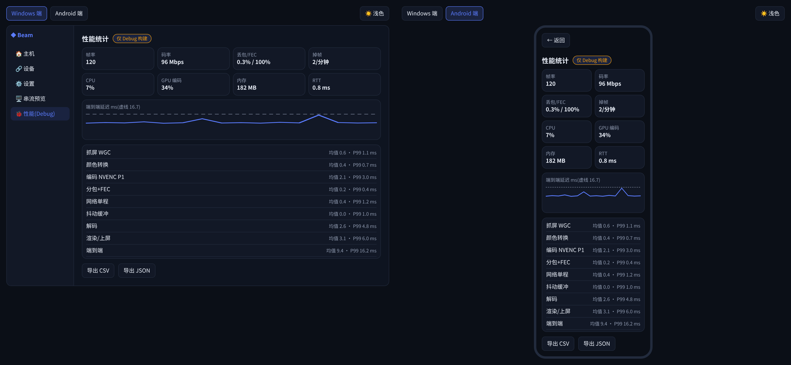
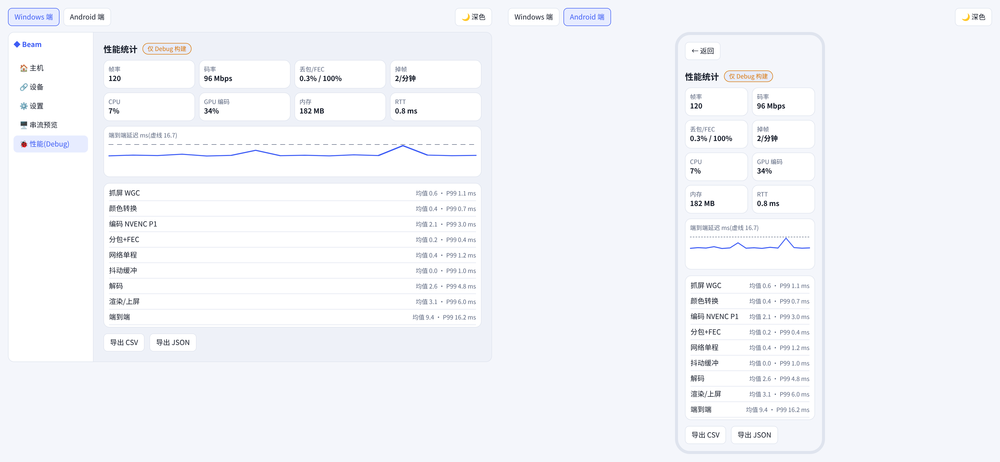

## 12. 库选型
| 用途 | Windows / Rust | Android |
|---|---|---|
| UI | Tauri 2 + React/Svelte | Jetpack Compose、TV Compose |
| 网络 | quinn | 复用 beam-net(uniffi + cargo-ndk) |
| 发现 | mdns-sd | 复用 / NsdManager |
| 证书/配对 | rustls、rcgen、spake2 | 复用 |
| 抓屏 | windows-capture、windows crate | — |
| 编解码 | ffmpeg-next(LGPL 动态链接) | MediaCodec |
| 音频 | wasapi + opus | Opus + AAudio |
| 输入 | SendInput、vigem-client | Compose 手势、InputDevice |
| 扫码 | qrcode(展示) | CameraX + ML Kit |
| 渲染 | wgpu / D3D11 | SurfaceView |

## 13. 里程碑
| 里程碑 | 内容 | 工期 |
|---|---|---|
| M0 原型 | Windows 主机 + 客户端打通抓屏→编码→QUIC→解码 | 第 1 天 |
| M1 MVP | Android 解码显示、输入回传、mDNS、扫码/PIN、托盘开播 | 第 2–3 天 |
| M2 可日用 | 音频、FEC、重连、延迟浮层、设置页、Debug 性能统计 | 第 2 周 |
| M2.5 高帧率 | 零拷贝 + 切片 + 帧节奏;4K60 达标,T2/T3 实测;Android 低延迟与高刷 | 第 3 周 |
| M3 v1 | 手柄、虚拟显示器、Android TV、GameStream 兼容层、安装包 | 第 3–5 周 |
| M4 v2 | HDR/AV1/120fps、外网、机型矩阵 | 第 6 周起 |

## 14. 风险与许可证
| 风险 | 对策 |
|---|---|
| ViGEmBus 已停止维护 | 手柄做可选组件,评估 VHF/UMDF 自研 |
| 虚拟显示器需驱动与签名 | 基于 IddCx 自研,早期测试签名 |
| 国产安卓 MediaCodec 差异 | 白名单 + 自动探测 |
| Wi-Fi 抖动花屏 | FEC + IDR 请求 + 自适应码率 |
| 与同类撞车 | 主打零配置、中文、电视、诊断 |
| 反作弊屏蔽 SendInput | 文档说明,v2 评估 |
| WGC 24H2 默认约 60fps | MinUpdateInterval + DXGI 回退 + 监控 |
| AMF/QSV 高帧率不稳 | 高帧率档先只开 NVENC |
| 安卓刷新率与锁帧 | 按设备刷新率限档并提示 |
| Wi-Fi 高码率 | 有线优先,Wi-Fi 自动限 120 Mbps |

- 自有代码 MIT/Apache-2.0;不得复制、翻译或让 AI 改写 Sunshine/Moonlight 的 GPL-3.0 代码。
- FFmpeg 只用 LGPL 构建,动态链接,附许可证与源码获取方式。
- 编码器 SDK 头文件分发前逐个核对;不使用 NVIDIA 商标做产品名。

## 15. 界面原型
可交互原型:[prototype/interactive.html](prototype/interactive.html)(浏览器直接打开)。页签切换 Windows/Android,右上角切换明暗。Windows 端可开播/停止、弹出二维码与 PIN 配对、移除设备(空态)、切换画质/编码/网络、开关延迟浮层、查看 Debug 性能面板;Android 端点已配对主机直连,未配对主机进入 PIN 配对(4827 成功,其他演示失败),串流中展开工具栏、模拟断线重连。

| 总览深色 | 总览浅色 |
|---|---|
|  | 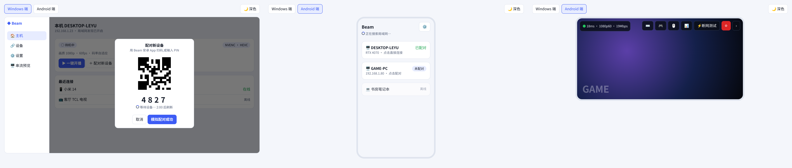 |

静态高保真(深色):
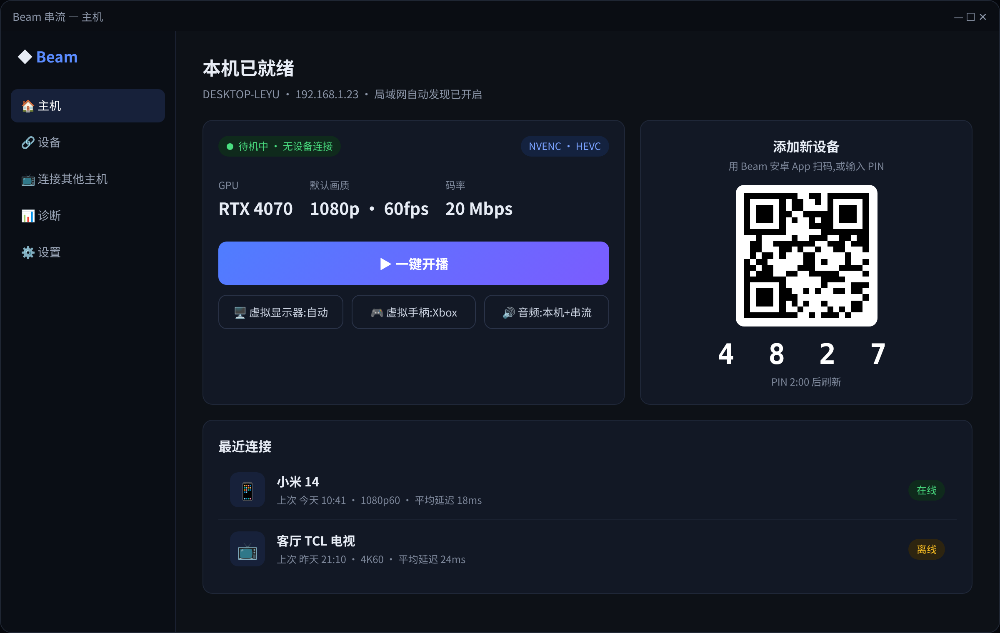 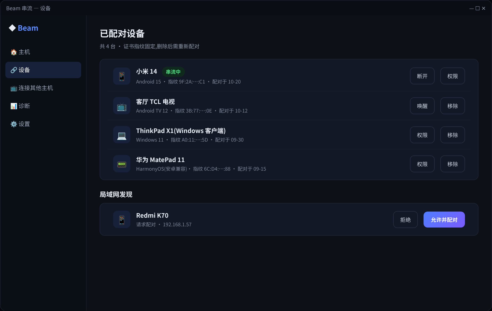 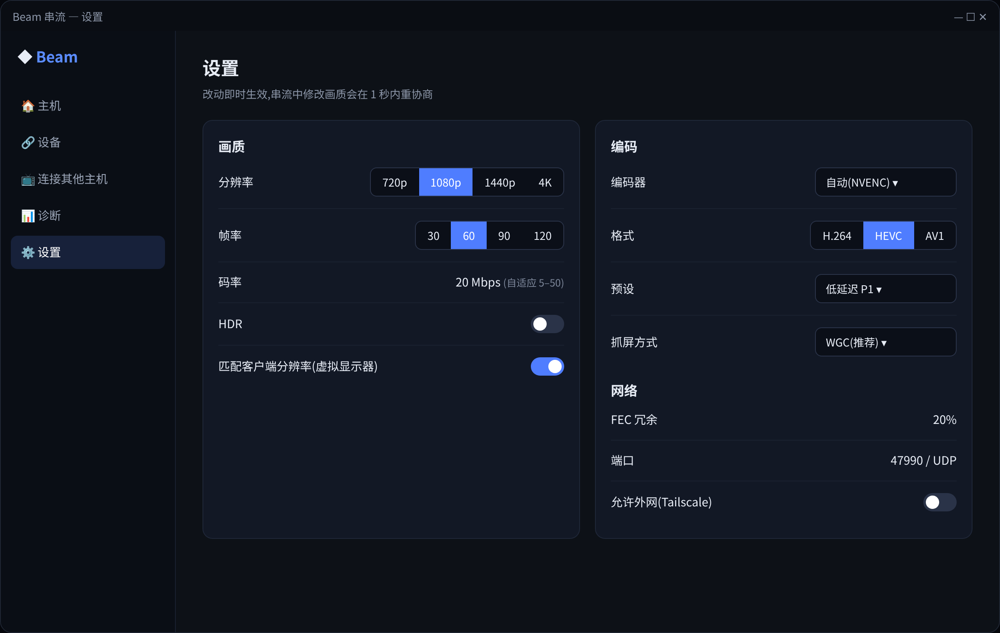 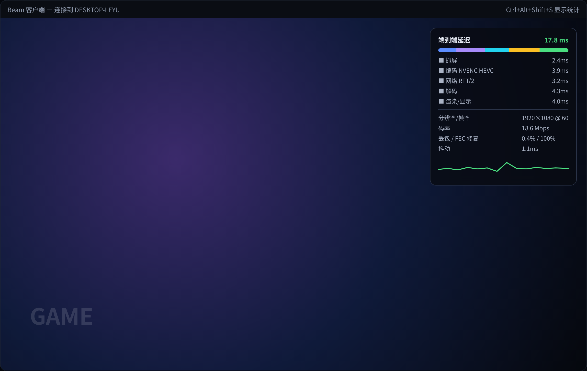
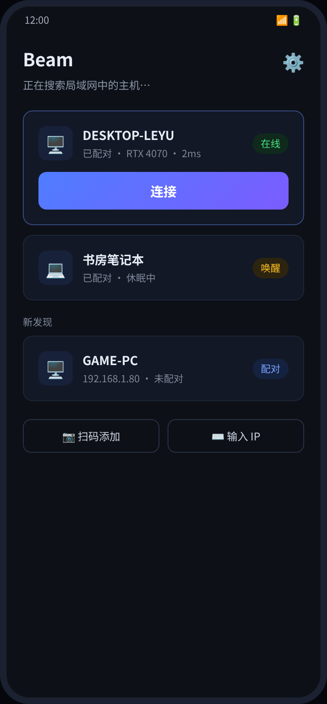 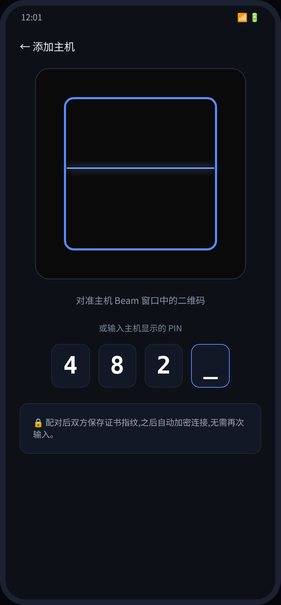 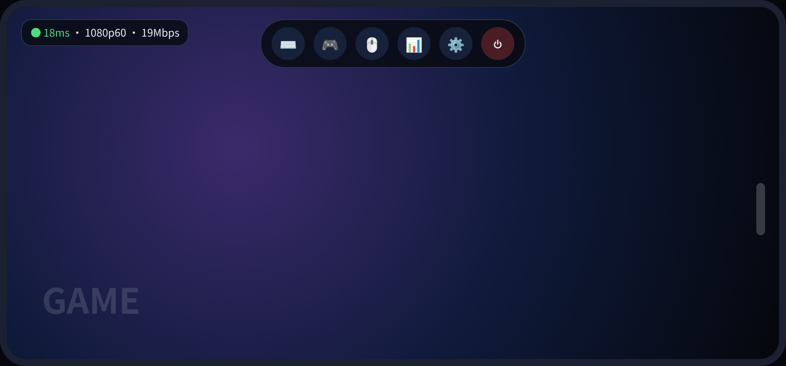 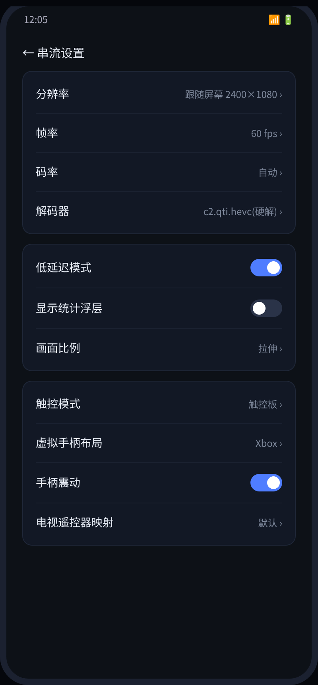

## 16. 设计规范
| 令牌 | 深色 | 浅色 | 用途 |
|---|---|---|---|
| 背景 bg | #0b0f17 | #f4f6fb | 页面底色 |
| 面板 panel | #121826 | #ffffff | 卡片、侧栏 |
| 分隔 line | #222b3d | #dfe4ee | 描边 |
| 正文 / 次要 | #e8edf6 / #8f9ab0 | #151b28 / #5d6880 | 文字 |
| 主色 | #5b7cff | #3d5cf5 | 主按钮、选中 |
| 成功/警告/错误 | #22c55e / #f59e0b / #ef4444 | #16a34a / #d97706 / #dc2626 | 状态 |
| 串流浮层 | #0a0e18 85% | 同深色 | 画面上浮层 |

- 字体:Windows Microsoft YaHei UI / Segoe UI,Android Noto Sans CJK;标题 18/600,正文 14/400,辅助 12/400,PIN 26/700。
- 间距 4 的倍数:卡片内边距 14、间距 12、页边距 20;圆角 按钮 8、卡片 12、手机外框 30。
- 组件:主/次/危险按钮、分段选择器、状态胶囊、设备行、模态弹窗、Toast、加载转圈、PIN 输入格。
- 状态:空态(图标+说明+主操作)、加载、错误(描红+剩余次数)、断线(遮罩+保留最后一帧)。

## 17. 来源
- NVENC Application Note:https://docs.nvidia.com/video-technologies/video-codec-sdk/13.0/nvenc-application-note/index.html
- Evolution of NVENC Efficiency:https://arxiv.org/html/2605.01187v1
- NVENC 切帧编码:https://developer.nvidia.com/blog/video-encoding-at-8k60-with-split-frame-encoding-and-nvidia-ada-lovelace-architecture/
- GPU 低延迟 4K 编码评测:https://arxiv.org/html/2511.18688
- AMF 切帧编码 issue:https://github.com/GPUOpen-LibrariesAndSDKs/AMF/issues/593
- Sunshine 音视频配置:https://www.mintlify.com/LizardByte/Sunshine/configuration/audio-video
- WGC 24H2 60fps:https://github.com/robmikh/Win32CaptureSample/issues/92
- WGC MinUpdateInterval:https://github.com/microsoft/Windows.UI.Composition-Win32-Samples/issues/142
- 骁龙低延迟解码:https://www.reddit.com/r/MoonlightStreaming/comments/1i9by7o/moonlight_latency_optimizations/
- 240fps 串流:https://www.reddit.com/r/MoonlightStreaming/comments/1dagtse/moonlight_sunshine_25g_ethernet_wifi_6ghz_upto/
- 4090 1440p 240Hz:https://www.reddit.com/r/cloudygamer/comments/1hxdij8/has_anyone_benchmarked_the_performance_cost_of/
- LG G4 + Apollo 4K120:https://www.reddit.com/r/MoonlightStreaming/comments/1heymei/host_pc_1440p_but_tv_is_4k_how_will_that_work/
- Artemis 锁帧机型:https://github.com/ClassicOldSong/moonlight-android/releases/tag/v12.1.250415
- 竞品:https://github.com/LizardByte/Sunshine · https://github.com/punktfunk/punktfunk
