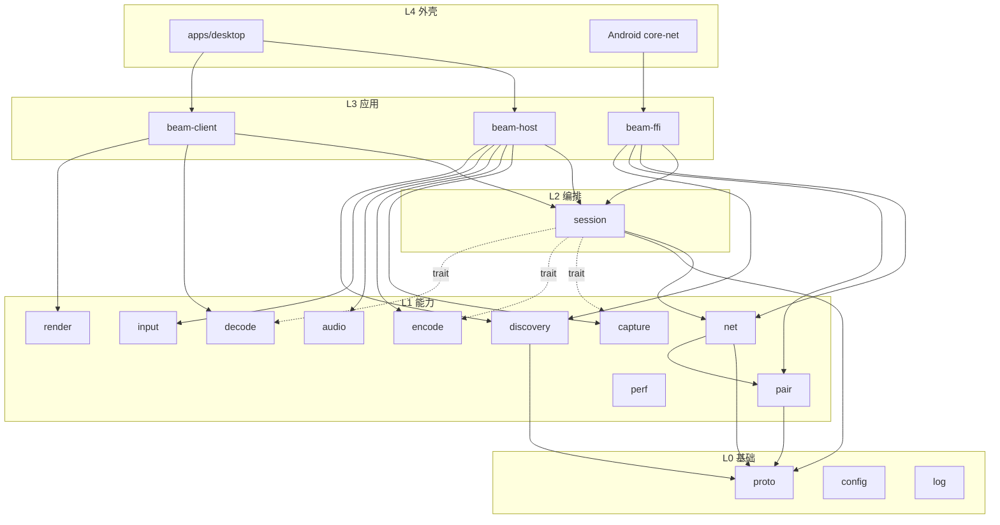
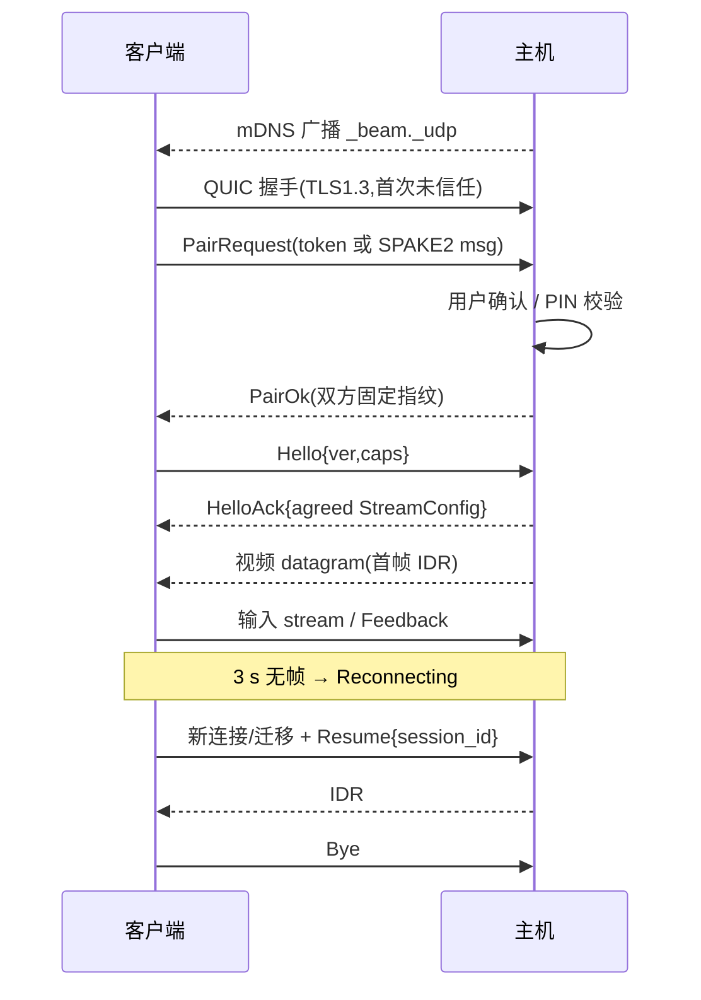

# Beam 串流 技术设计文档 v0.1

> 日期:2026-10-29 · 依据:《Beam 串流:Windows + Android 产品与技术方案》Page · 状态:草案
> 所有耗时数字均为设计预算,不是实测;外部数据只沿用方案页已列来源。

## 1. 范围、术语、目标

### 1.1 文档范围
覆盖 Beam 主机(Windows)、Windows 客户端、Android 客户端(手机/平板/TV)的模块划分、接口、协议、构建发布、测试与工作拆解。不覆盖:官网、账号体系、云中继运营。

### 1.2 术语
| 术语 | 含义 |
|---|---|
| 主机 Host | 运行游戏、抓屏编码的 Windows PC |
| 客户端 Client | 解码显示并回传输入的设备(Windows / Android) |
| 会话 Session | 一次从建连到断开的串流过程 |
| 帧组 FEC Group | 同一视频帧的数据分片 + 冗余分片 |
| IDR / Intra-refresh | 关键帧 / 渐进式帧内刷新 |
| E2E | 端到端延迟:主机抓屏时刻 → 客户端上屏时刻 |
| 档位 Tier | T1=4K60,T2=1440p165,T3=1080p200 |
| perf-stats | 仅 Debug 构建的性能统计模块 |

### 1.3 目标 / 非目标
| 阶段 | 做 | 不做 |
|---|---|---|
| MVP | Windows 主机(WGC+NVENC/AMF/QSV HEVC、SendInput 键鼠);Windows/Android 客户端硬解显示;QUIC 视频 datagram + 控制 stream;mDNS;扫码/PIN 配对;1080p60 局域网 | 音频、手柄、虚拟显示器、FEC 自适应、GameStream 兼容、外网 |
| v1 | 音频 Opus、ViGEm 手柄、虚拟显示器、FEC + 自适应码率、断线重连、Android TV、GameStream 兼容层、T1 达标,T2/T3 在 NVENC + Windows 客户端达标、perf-stats | HDR、AV1 默认、多显示器、文件传输 |
| v2 | HDR、AV1、120fps+ Android、多显示器、剪贴板、WOL、Tailscale 引导/中继 | 云游戏托管、macOS/Linux 主机、iOS 客户端(另立项) |

明确不做:账号/云同步、录屏直播、远程办公级文件管理、对反作弊游戏的驱动级输入(v2 再评估)。

## 2. 仓库与工程结构
```
beam/
├─ Cargo.toml                # workspace
├─ crates/
│  ├─ beam-proto/            # 消息、帧头、版本协商(no_std 友好)
│  ├─ beam-net/              # quinn、分包、FEC、码率控制、抖动缓冲
│  ├─ beam-pair/             # 证书、扫码载荷、SPAKE2 PIN、信任库
│  ├─ beam-discovery/        # mdns-sd
│  ├─ beam-session/          # 会话状态机(主/客两侧)
│  ├─ beam-capture/          # WGC / DXGI (windows only)
│  ├─ beam-encode/           # ffmpeg-next: NVENC/AMF/QSV (windows only)
│  ├─ beam-audio/            # WASAPI loopback + Opus 编码;客户端 Opus 解码
│  ├─ beam-input/            # SendInput、ViGEm (windows only) + 输入事件模型
│  ├─ beam-decode/           # Windows 客户端 D3D11VA 解码
│  ├─ beam-render/           # Windows 客户端 D3D11 交换链
│  ├─ beam-config/           # 配置读写、优先级合并、存储
│  ├─ beam-log/              # tracing 初始化、日志轮转
│  ├─ beam-perf/             # perf-stats(feature = "perf-stats")
│  ├─ beam-host/             # 主机编排
│  ├─ beam-client/           # Windows 客户端编排
│  ├─ beam-ffi/              # uniffi 导出给 Android
│  └─ beam-gamestream/       # GameStream 兼容层(v1 新增,仅按公开协议行为实现)
├─ apps/desktop/             # Tauri 2
│  ├─ src/                   # 前端 (React + TS)
│  │  ├─ pages/ (Home, Devices, Settings, Connect, Perf)
│  │  ├─ components/ ipc/ stores/ i18n/
│  └─ src-tauri/ (commands.rs, events.rs, tray.rs, main.rs)
├─ android/
│  ├─ app/  feature-discovery/  feature-pairing/  feature-stream/  feature-settings/
│  ├─ feature-perf/          # 仅 debug 依赖
│  ├─ core-decoder/ core-renderer/ core-input/ core-audio/ core-data/
│  └─ core-net/              # uniffi 生成的 Kotlin + jniLibs/libbeam_ffi.so
├─ drivers/                  # 虚拟显示器(IddCx)与安装脚本(v1)
├─ docs/  tools/ (bench, pcap 解析)  .github/workflows/
```

## 3. 模块设计(统一模板)
每节字段:职责|边界(负责/不负责/依赖/被依赖/禁止)|接口|数据结构|线程模型|错误码|配置|性能预算(T1/T2/T3)|测试|里程碑

### 3.1 beam-proto
- 职责:所有线上消息与帧头的定义、序列化(postcard)、版本协商。
- 边界:只含类型与编解码;不做 IO。依赖 serde/postcard;被 net/session/ffi 依赖;禁止依赖任何平台 crate 或 tokio。
- 接口:`fn encode<M: Message>(m:&M, buf:&mut BytesMut)`;`fn decode(buf:&[u8]) -> Result<AnyMsg, ProtoError>`;`fn negotiate(local:&Caps, remote:&Caps) -> Result<Agreed, ProtoError>`
- 数据:`Hello{ver,caps}`、`Caps{codecs,max_res,max_fps,features}`、`StreamConfig`、`InputEvent`、`StatsReport`、`VideoPktHeader`(见第 5 章)。
- 线程:纯函数。 错误码:`E1xxx`(1001 版本不兼容,1002 解码失败,1003 未知消息)。
- 配置:无。 性能:单消息编解码 < 2 µs。 测试:proptest 往返、模糊测试 cargo-fuzz、版本兼容快照。 里程碑:MVP。

### 3.2 beam-net
- 职责:quinn 端点;视频/音频 datagram 分包与重组;Reed-Solomon FEC;码率控制(基于丢包与 RTT 的 GCC 简化版);接收端抖动缓冲;连接统计。
- 边界:不懂编码格式,只搬字节;不做配对决策(TLS 校验回调由 pair 提供)。依赖 proto、pair(验证器 trait)、quinn、reed-solomon-erasure;被 session、ffi 依赖。禁止依赖 capture/encode/decode。
- 接口:
```rust
pub struct NetEndpoint; impl NetEndpoint {
  pub async fn listen(cfg: NetConfig, verifier: Arc<dyn PeerVerifier>) -> Result<Self, NetError>;
  pub async fn connect(addr: SocketAddr, cfg: NetConfig, verifier: Arc<dyn PeerVerifier>) -> Result<Conn, NetError>; }
pub trait VideoSender { fn send_frame(&self, f: EncodedFrame) -> Result<(), NetError>; }
pub trait VideoReceiver { async fn next_frame(&mut self) -> Result<AssembledFrame, NetError>; }
pub struct RateController { pub fn on_feedback(&mut self, fb: &Feedback) -> BitrateDecision; }
```
- 数据:`EncodedFrame{frame_id,pts_us,capture_ts_us,is_key,slices:Vec<Bytes>}`、`AssembledFrame`、`Feedback{loss,rtt,recv_rate}`。**帧头不带独立的 pts 字段**:接收端 `pts_us = capture_ts_us` —— 低延迟串流刻意不做重排序缓冲,pts 与抓屏时刻同源才是想要的语义。
- 线程:tokio 多线程运行时;发送路径专用任务,UDP GSO 批量发包;接收重组单任务;FEC 解码在 rayon 或 blocking 线程。
- 错误码:`E2xxx`(2001 连接超时,2002 证书拒绝,2003 datagram 不支持,2004 帧过期丢弃)。
- 配置:`fec_ratio`(默认 0.2,码率>150 Mbps 时下调到 0.1)、`max_datagram=1200`、`jitter_frames`(有线 0,Wi-Fi 自适应 0–1)、`bitrate_min/max`。
- 性能:分包+FEC 编码 T1 ≤0.8 ms、T2 ≤0.4 ms、T3 ≤0.3 ms;重组+FEC 恢复同量级。
- **数据报分流读点(B20)**:§5 里视频与音频走**同一条** datagram 通道，靠帧头 `type` 区分(`0` 视频 / `1` 音频 / `2` FEC 冗余)。而画面重组器**不看 `type`** —— 它把每一条数据报都当画面分片处理⇒ 音频数据报会被组装成「一帧画面」(负载是裸 Opus 字节，没有视频路径那 8 字节前缀)，解码出来是垃圾；音频帧号又与画面帧号同号段 ⇒ 两边的分片还会互相污染。所以「按 `type` 分流」必须发生在**唯一读走数据报的地方**。这个读点是 `beam_net::DemuxStream`(`drain` 把 `type = 0/2` 送进画面重组器 + 抖动缓冲，把 `type = 1` 与保留类型交给调用方的回调)；`beam_client::DemuxTransport` 与**主机侧整链验证入口**都用它 ⇒ **全仓只有一份分流实现**。放在 `beam-net`(L1)而不是 `beam-client`(L3)：§4 规定 L3 之间不得横向依赖(`beam-host` 与 `beam-client` 同层)，而主机侧的整链验证入口也需要同一个分流读点。

### 3.3 beam-pair
- 职责:Ed25519 自签证书(rcgen);信任库;二维码载荷 `beam://pair?h=ip:port&fp=..&t=token`;SPAKE2 PIN;实现 rustls 校验器。
- 边界:不做网络 IO(PIN 交换消息由 session 经 net 传递);依赖 proto、rustls、rcgen、spake2;被 net/session/ffi 依赖;禁止依赖 UI。
- 接口:`Identity::load_or_create(store)`;`fn qr_payload(&self, addr) -> PairPayload`;`PinPairing::start(pin) -> (Self, Msg)`/`finish(msg) -> Result<Fingerprint,_>`;`impl PeerVerifier for TrustStore`。
- 数据:`Fingerprint([u8;32])`、`TrustedPeer{fp,name,platform,paired_at,perms}`。
- 线程:同步 API,在调用方任务内执行。 错误码:`E3xxx`(3001 PIN 错误,3002 次数超限锁定 60 s,3003 token 过期,3004 指纹不匹配)。
- 配置:`pin_len=4`、`pin_ttl=120s`、`max_attempts=3`。 性能:不在热路径。 测试:中间人模拟、错误 PIN、过期 token。 里程碑:MVP。
- **「还没配对好」与「PIN 错了」要分开(B24/B25)**:主机在配对模式下对未配对的对端回 `PairFail{code: 3008}`（**E3008**，段内扩展）—— 用户在主机弹窗里点「同意」**之前**，这**不是** PIN 错误（PIN 可能完全正确，只是还没点确认）。客户端收到 3008 时**不判死**：它进入「等确认」状态，按 1 s 间隔**重建连接**、重新发起一次握手（§4.1）⇒ 用户点一次「同意」就能连上，不必再点一次「连接」。**码位从 B24 的 3006 改成 3008**：`beam-pair` 已经占用了 `E3006`（身份材料读写失败），两个完全不同的事共用一个码 ⇒ 前端会把「等确认」展示成「证书读写失败」。**主机侧收到未配对的 `Hello` 时不能把会话打死**（回复本身就是答案），否则 `PairFail` 会被丢掉、客户端等不到「等确认」。
- **传输工厂异步化(B25,上面那个问题已解)**:会话层的 `TransportFactory` 改成**只发起、不阻塞**的 `start_connect() -> Box<dyn PendingTransport>`：工厂在 tokio 运行时里**异步**建链，会话层在 `pump()` 里**非阻塞**地问结果（`poll_result()`）。首连、重连（§4.1「新连接/迁移」）、以及「等确认」的重建，全部走这一条路 ⇒ 以后不再有 `block_on` 卡运行时的写法。`beam-client` 的 `NetTransportFactory` / `DemuxTransportFactory` 与 `beam-ffi` 的 `ClientTransportFactory` 都能**真的重建**一条连接（每次 `start_connect()` 都是一条新连接）；一次性工厂 `ReadyTransportFactory` 保留，但**只能交出同一条连接**（文档里写明它不能用于重连）。
- **PIN 密码学校验已接线并真机验证(B21)**:此前 PIN 只到「格式校验 + 尝试预算」（桌面端 `pin.rs`），**密码学验证从未真正发生** —— 主机侧没把 PIN 配进 `PairingConfig`，信任闸门又在 TLS 层就把未信任对端拒了，客户端连控制通道都到不了。现在补齐了三段接线:① `beam-client` 的 `ClientConfig.pin` → 会话层 `PairingConfig` ⇒ 客户端在控制通道上发起 SPAKE2，**配对成功之后才发 `Hello`**;② `beam-host` 的信任闸门增加**配对模式**（未信任对端的握手放行，但**控制面**必须先完成配对才准进串流）—— 安全兜底从 TLS 层移到控制面（会话层在 `require_pairing` 为真时**拒绝**未配对对端的 `Hello`）;③ 配对成功后主机把对端指纹**写进信任库**（`beam-host` 的 `HostSessionHandle::spawn_trust_writer`，桌面端与验证入口共用同一份实现）。验证入口 `crates/beam-client/examples/pairing_loopback.rs`，三个阶段全过:**错 PIN ⇒ 被拒且信任库保持为空**、**对 PIN ⇒ 配对成功并写库 ⇒ 进串流**、**已配对 ⇒ 不传 PIN 也免配对直接放行**。
- **SPAKE2 的密码学证明在客户端那一步才成立(B21 实测)**:主机收到客户端的首条挑战时，**只能**记下对端指纹，**不能**坐实配对 —— 因为密码学证明是客户端拿自己的 PIN 去校验主机应答时得出的，对不上它会回 `PairFail`。若主机在「收到挑战」时就坐实配对并写信任库，那么一个**输错 PIN** 的客户端也会被当成已配对设备（实测：修复前错 PIN 也会写进信任库）。所以主机的顺序是:收到挑战 ⇒ 记住对端指纹 ⇒ 等客户端回 `PairOk`（= 它真的过了 PIN 校验）⇒ 才坐实。（token 路径不同:一次性 token 本身就是客户端「知道口令」的证明，当场即可坐实。）

### 3.4 beam-discovery
- 职责:mDNS 广播 `_beam._udp.local`(TXT:id、name、ver、fp 前 8 位、port、**plat 平台标识**)与浏览。`plat` 是**追加字段**:对端不带它时按「未知平台」处理,不影响发现;带上它才能让信任库的 `TrustedPeer.platform` 不是恒定的未知值。
- 边界:只发现不连接;依赖 mdns-sd;被 host/client/ffi 依赖。Android 可选用 NsdManager 兜底(在 Kotlin 层)。
- 接口:`Advertiser::start(info)`;`Browser::start() -> impl Stream<Item=DiscoveryEvent>`。 错误码 `E4xxx`。 配置:`enabled`、`iface_allowlist`。 测试:多网卡、组播被阻断回退手动 IP。 里程碑:MVP。

### 3.5 beam-capture(Windows)
- 职责:WGC(主)/DXGI 复制(回退)抓屏,输出 GPU 上的 D3D11 纹理;设置 `MinUpdateInterval`;光标单独通道。
- 边界:不做颜色转换和编码;不拷到 CPU。依赖 windows-capture、windows crate;被 host 依赖。禁止依赖 net。
- 接口:
```rust
pub trait CaptureSource: Send { fn start(&mut self, cfg: CaptureConfig) -> Result<(), CapError>;
  fn latest(&mut self) -> Option<CapturedFrame>; /* 非阻塞,取最新 */ fn stop(&mut self); }
pub struct CapturedFrame { pub tex: ID3D11Texture2D, pub ts_us: u64, pub dirty: bool }
```
- 线程:WGC 回调线程只更新“最新帧”槽(单槽交换);编码节拍线程按目标帧率拉取。
- 错误码 `E5xxx`(5001 无显示器,5002 独占全屏无法抓取→切 DXGI,5003 设备丢失)。 配置:`backend=auto|wgc|dxgi`、`display_id`、`min_update_interval`。
- 性能:抓屏+取纹理 T1 ≤1.5 ms、T2/T3 ≤1 ms;必须能交付 ≥ 目标帧率(主机显示器刷新率需 ≥ 目标)。
- 测试:帧率计数(165/240Hz 显示器)、设备丢失恢复、多显示器;Windows 10 22H2 实测抓屏帧率上限。 里程碑:MVP(WGC)/v1(DXGI 回退、虚拟显示器)。
- 平台限制:`MinUpdateInterval` 需 SDK 26100(Windows 11 24H2)。Windows 10 22H2 无此能力,MVP 阶段又无 DXGI 回退,抓屏上限约 60fps——1080p60 恰好够但无余量,M1 验收须含 Windows 10 实测项。

### 3.6 beam-encode(Windows)
- 职责:GPU 上 RGB→NV12(D3D11 VideoProcessor 或 compute shader);NVENC/AMF/QSV 硬编(ffmpeg-next 封装,D3D11 硬件帧上下文);低延迟参数;切片输出;强制 IDR;码率热更新。
- 边界:不负责发包;依赖 ffmpeg-next(LGPL 动态库)、windows;被 host 依赖。禁止依赖 net/session。
- 接口:`trait VideoEncoder { fn encode(&mut self, f:&CapturedFrame) -> Result<EncodedFrame, EncError>; fn request_idr(&mut self); fn set_bitrate(&mut self,bps:u32); }`;`fn probe() -> Vec<EncoderCaps>`。
- 参数基线:NVENC P1 + ultra-low-latency、CBR、无 B 帧、无 lookahead、VBV=1 帧、intra-refresh;Ada 上 T1 及高帧率档开启 SFE;AMF `ultralowlatency`+`vbr_latency`;QSV `veryfast`。
- 线程:单独编码线程(与节拍线程合并),同步调用。 错误码 `E6xxx`(6001 无可用硬编,6002 会话数超限,6003 参数不支持→降档)。
- 配置:`encoder=auto|nvenc|amf|qsv`、`codec=hevc|h264|av1`、`slices`、`sfe`。
- 性能:颜色转换+编码 T1 ≤7 ms(Ampere 级,Ada ≤4 ms)、T2 ≤3 ms、T3 ≤2 ms;AMF/QSV 的 T2/T3 为实验档。
- 测试:probe 矩阵、各档 P99 编码耗时基准、码率切换无花屏。 里程碑:MVP / v1(切片、SFE)。

### 3.7 beam-audio
- 职责:主机 WASAPI loopback 48 kHz → Opus 5 ms 帧;Windows 客户端 Opus 解码 + WASAPI 输出;Android 由 core-audio 解码(可复用 ffi 中的 Opus 解码)。
- **音频整链已验证(B20)**:主机侧真采集(WASAPI loopback)→ 真 Opus 编码 → QUIC datagram → 客户端侧按帧头 `type` 分流 → 真 Opus 解码 → 真 WASAPI 输出 ⇒ 本机实测 **800 帧走完整链**(采集发出 800 / 客户端解码 800 / 回放到设备 800，错误 0 次)，解码 PCM 的 RMS = 0.084、峰值 = 0.148(非静音 ⇒ 采到的是真声音，不是空数据)。验证入口:`crates/beam-host/examples/client_loopback.rs`(与画面整链同一个入口)；速率对照入口 `crates/beam-audio/examples/audio_rate_probe.rs`。三个坑要记住:① **loopback 只采渲染流** —— 系统没在播声音就一帧都没有，所以验证入口会自己播一段 440 Hz 测试音(与「WGC 是内容驱动的」同一个道理);② **音频帧是 5 ms 一帧 ⇒ 实时需要 200 帧/秒** —— 消费循环若「一轮只取一帧」，速率就被**循环的唤醒间隔**限死(实测 15 ms 的唤醒间隔 ⇒ 只有 65 帧/秒，采集队列一路积压到丢帧)，必须**一轮把攒下的帧全发走**(改完后实测 800 帧 / 4 秒 = 200 帧/秒，队列零积压);③ **同一台机器上跑两端会形成反馈回路** —— 客户端把收到的音频回放到默认渲染端点，主机的 loopback 又把它采回来，所以顺序必须是「主机先停采集(`HostSessionHandle::stop_audio`)→ 客户端再回放」。

### 3.8 beam-input
- 职责:输入事件模型(在 proto 定义);主机侧 SendInput 注入键鼠、vigem-client 虚拟 Xbox 手柄、震动回传;权限控制(按设备)。
- 边界:不采集客户端输入(Windows 客户端由 beam-client 采集,Android 由 core-input)。禁止依赖 capture/encode。
- 接口:`trait InputSink { fn apply(&mut self, ev: InputEvent) -> Result<(), InputError>; }`;`GamepadHub::attach(slot) -> GamepadHandle`。
- 线程:输入 stream 接收任务 → 有界通道 → 注入线程(高优先级)。错误码 `E8xxx`(8001 ViGEmBus 未安装,8002 权限拒绝,**8004 键码无法映射为 HID/VK**——与 8001/8002 同段的**段内扩展**)。滚轮 `Scroll{dx,dy}` 为 **Q16.16 定点数**,**整数部分表示滚轮刻度**(1 刻度 = 鼠标滚轮一格;Windows 注入侧再乘 `WHEEL_DELTA=120`),小数部分留给高精度滚轮。性能:接收→注入 ≤1 ms。测试:回放脚本、手柄热插拔。里程碑:MVP(键鼠)/v1(手柄)。
- **客户端采集已落地(B22)**:§3.8 的边界写着「不采集客户端输入(Windows 客户端由 beam-client 采集)」—— `beam-client` 新增 `capture` 模块:`WindowsInputCapture` 用**低级钩子**(`WH_KEYBOARD_LL` / `WH_MOUSE_LL`)采集**全局**键鼠(普通窗口钩子只能拿到**本进程**的输入,而串流要转发的是用户在**别的应用**里的操作)。低级钩子的回调在**安装它的线程**上执行 ⇒ 该线程必须跑消息循环(`GetMessageW`),否则 Windows 会把钩子摘掉。
- **键码口径只有一张表(B22)**:钩子给的是 Win32 **虚拟键码**,而协议侧 `InputEvent::Key.code` 是 **USB HID 用法 ID** ⇒ 采集侧用 `beam_input::hid::vk_to_hid` 翻译,与主机侧注入用的 `hid_to_vk` **是同一张表**(`beam_input::hid`)。两边各写一张表,迟早会漂移(一边加了键、另一边没有 ⇒ 按这个键没反应)。
- **不回采「注入事件」(B22)
- **桌面端已接上客户端采集(B23)**:设置页新增「把本机键鼠回传给主机」开关(`DesktopSettings.share_input`,**默认关** —— 把自己的键盘发给远端主机是敏感操作,必须用户主动开启);打开时 `connect` 会装上 `WindowsInputCapture` 并交给客户端运行时。采集装不上**不影响连接**(只是本次不回传输入,画面照常)。
- **三个实测坑(B23)**:① `thread_local!` 写在两个不同的函数里就是**两个不同的变量** —— 钩子回调读到的那个永远是默认值(实测:注入事件被「跳过注入事件」的判断挡掉,一个都采不到) ⇒ 线程局部状态必须**只有一处声明**;② `WindowsInputCapture::start()` **必须等钩子真的装好**再返回(装不上也要带着原因返回),否则调用方拿到的是「还在装」的中间状态,会误判成失败;③ HID↔VK 表里**左右修饰键**之前映射错了(右 Ctrl/Shift/Menu 用的是左边的常量) ⇒ 右侧修饰键既采不到也注不准,已按 HID 0xE0..0xE7 修正为 `VK_LCONTROL`/`VK_RCONTROL` 等。
- **真实低级钩子已端到端验证(B23)**:验证入口 `crates/beam-client/examples/input_loopback.rs`(设 `BEAM_REAL_CAPTURE=1` 用**真实钩子**,默认用脚本源保证可重复):注入一个测试键 ⇒ 客户端钩子采到 **2** 个事件(Ctrl 下/上)⇒ 主机注入器统计 **submitted = 2 / injected = 2 / denied = 0** ⇒ 「钩子 → 会话 → §5 输入流 → 主机 SendInput」全链打通。**:带 `LLKHF_INJECTED` / `LLMHF_INJECTED` 标记的事件是**别的程序注入**的(包括本机另一端的主机注入)⇒ 一律跳过。否则会形成「注入 → 采集 → 回传 → 再注入」的回环。
- **输入回传链路已打通(B22)**:会话层新增 `InputSource`(§3.8 边界在会话层的镜像:会话层不认识任何平台采集后端,只从它取事件写进 §5 的**输入单向流**);`beam-client` 的 `ClientRuntime::with_input` 装上采集源;主机侧照旧是「输入 stream 接收任务 → 有界通道 → 注入线程(高优先级/MMCSS)」。
- **输入回传已端到端验证(B22)**:验证入口 `crates/beam-client/examples/input_loopback.rs`——客户端事件 → §5 输入单向流 → 主机输入泵 → 注入线程(MMCSS/Games)→ SendInput。本机实测:客户端发出 2 个事件,主机注入器统计 **submitted = 2 / injected = 2 / denied = 0**—— 真的调过 `SendInput`。判据用**注入器自己的统计**,不用光标位移:光标位移会被「用户自己在动鼠标」干扰(实测:注入器一个事件都没收到,光标却「位移 97 像素」—— 那是用户的手)。
- **回传链路上有个真实的坑(B22)**:客户端会话**进串流后不能就不再泵**——「把采集到的事件写进输入单向流」发生在会话层的 `pump` 里。不再泵 ⇒ 事件一直堵在采集源里,直到任务结束才被取出,而那时连接正要关闭 ⇒ 数据发不出去(主机侧报「接受输入流失败 closed by peer」)。

### 3.9 beam-session
- 职责:主/客会话状态机;串联 capture→encode→net、net→decode→render;能力协商、IDR 请求、重连、统计汇总。
- 状态:`Idle → Discovering → Pairing → Connecting → Negotiating → Streaming ⇄ Reconnecting → Closed`;`Error` 可从任意状态进入。
- 接口:`HostSession::start(cfg, deps) -> SessionHandle`;`ClientSession::connect(peer, cfg) -> SessionHandle`;`SessionHandle::{events()->Stream<SessionEvent>, update(StreamConfig), stop()}`。
- 边界:不直接调用平台 API,通过 trait(CaptureSource/VideoEncoder/VideoSender/…)注入,便于测试。被 host/client/ffi 依赖。
- 错误码 `E9xxx`。配置:`reconnect_timeout=30s`、`stall_threshold=3s`。测试:状态机表驱动测试 + 假实现集成测试。里程碑:MVP(无重连)/v1。
- **传输重建是异步的(B25)**:会话层是同步的（`pump()` 由调用方在自己的任务里推进），而建 QUIC 连接是异步的 ⇒ 工厂只**发起**建链（`TransportFactory::start_connect`），会话层用 `PendingTransport::poll_result()` **非阻塞**地问结果：还没好就 `None`，好了就装上传输并推进状态机（首连 → `Connecting→Negotiating`；重连 → `Hello` + `Resume{session_id}`；等确认 → 重新握手）。这让 §4.1 的「新连接/迁移」重连在真实链路上**真的换一条连接**（真机实测：客户端在等确认期间换了 5 条连接，掉线后又换了第 6 条并恢复串流）。

### 3.10 beam-decode / beam-render(Windows 客户端)
- 职责:ffmpeg D3D11VA 硬解 HEVC/H.264(/AV1 v2);解码纹理直接交给 D3D11 flip-model 交换链,支持可变刷新率;叠加层由 Tauri 窗口负责。
- 接口:`trait VideoDecoder { fn decode(&mut self, f: AssembledFrame) -> Result<DecodedFrame, DecError>; }`;`Renderer::present(&DecodedFrame)`。
- 线程:解码线程 → 单槽 → 渲染线程(按 vblank)。错误码 `E10xxx`。性能:解码 T1 ≤8、T2 ≤5、T3 ≤4 ms;上屏等待平均半帧。测试:各显卡解码基准、丢帧统计。里程碑:MVP(简版)/v1。
- **整链已验证(B19)**:主机侧真抓屏(WGC)+ 真硬编(NVENC)→ QUIC → 客户端侧真硬解(D3D11VA)+ 真上屏(独立原生窗口,§3.10「画面不走 WebView」)⇒ 本机实测 345 帧**全部**经 VideoProcessor 转换后搬进交换链(`PresentInfo::converted_presents` = 345、降级 = 0),验证入口 `crates/beam-host/examples/client_loopback.rs`。两个坑要记住:① **WGC 是内容驱动的**(只在画面变化时投递新帧)⇒ 屏幕上完全静止时主机一帧都发不出来,验证入口会自己起一个持续刷新屏幕的后台进程,否则同一台机器上帧数在 0 与 1 之间跳;② **客户端必须比主机活得久**(客户端一断开,主机的控制流就断了 ⇒ 主机会话必然进 Error 态,那是正常的断开语义,不是故障)。
- **格式转换(B17/B18 实测)**:D3D11VA 视频解码的原生输出是 `DXGI_FORMAT_420Opaque`(4:2:0 双平面,纹理高度是**对齐后**的 coded height,1080p 实测 1920×1152),而 flip-model 交换链**不接受** 4:2:0 视频格式(实测 `DXGI_FORMAT_420Opaque` / `DXGI_FORMAT_NV12` 建链均失败)⇒ **「解码纹理零拷贝交给交换链」不可行**,必须先做 4:2:0 → BGRA 的转换。转换走 **D3D11 VideoProcessor**(硬件):输入视图的 `FourCC` 必须用 **`'420O'`**(`MAKEFOURCC('4','2','0','O')` = `0x4F303234`)—— 用 DXGI 枚举值或 `'W8B8'` 都建不出来(`beam-encode` 那次 96 组变体全灭,是因为它的源纹理是自造的 NV12/BGRA,没有试过 `'420O'`)。转换按**可见高度**采样(4:2:0 的 Y 平面行距 = 宽度,解码器把画面写在前面、后面是 padding)。本机实测:9 帧全部经转换后搬进交换链,`PresentInfo::converted_presents` = 9、降级 = 0。实现上**不静默降级**:转换也不可用时如实报 `E10015`(非文档码位),而不是清屏后假装在串流;`beam_render::PresentInfo` 分别统计「真的搬纹理」「经转换搬纹理」「降级」,是判断画面是否上屏的**唯一可靠依据**。另:`IDXGISwapChain::GetFrameStatistics` 按微软说明**不支持 flip-model** ⇒ 交换链丢帧统计在本路径下不可用。
- **抓屏依赖「桌面真的在变」(B21 实测)**:WGC 是内容驱动的，画面不变就没有新帧。这条约束比看上去更狠 —— **桌面处于锁屏状态时，锁屏画面除了时钟几乎不变** ⇒ 抓屏只能拿到 3 帧（初始合成），而**音频照常 800 帧**（音频不依赖桌面）。因此「画面 0 帧 + 音频正常」这个组合**通常不是代码坏了，而是会话被锁了**。验证入口 `client_loopback` 在画面 0 帧时会直接提示这一点。另外，验证入口自带的刷屏进程必须是 **TopMost** 的小窗口（PowerShell + WinForms，每 40 ms 换一次底色）:先前用「往控制台打点的 cmd 进程」有两个问题 —— 循环很快就跑完（之后桌面不再变化），且那个控制台窗口会被客户端 1920×1080 的串流窗口盖住。
- **上屏性能已实测(B20)**:§3.13 的采集器把整链各阶段耗时真的采下来(本机 RTX 3070 / 1080p / HEVC 硬解):**解码**均值 **0.348 ms**、p99 1.500 ms、最大 21.116 ms ⇒ 对 §3.10 的「解码 T1 ≤8 ms」**达标**;**上屏(含 VideoProcessor 转换 + 交换链 Present)**均值 **0.106 ms**、p99 0.375 ms ⇒ 对「上屏等待平均半帧」(60 fps ⇒ 8.33 ms)**达标**。采集入口:`crates/beam-host/examples/client_loopback.rs --features perf-stats`(§7:release 禁开 perf-stats，所以它是独立 feature)。同一次运行里 285 帧全部经转换后搬进交换链、降级 0。

### 3.11 host-app / client(Tauri,apps/desktop)
- 职责:UI、托盘、通知;只通过 commands/events 与 Rust 交互;视频帧不经 IPC。
- Commands:`get_host_status`、`start_hosting(opts)`、`stop_hosting`、`get_pairing_code`、`approve_pair(id)`、`reject_pair(id)`、`remove_device(id)`、`list_hosts`、`connect(host_id, pin)`、`disconnect`、`get_settings`、`set_settings(patch)`;debug 下另有 `perf_snapshot`、`perf_export(format)`。
  `pin` 是客户端输入的 4 位 PIN(§3.3 `pin_len=4`);**已配对的主机可传空串**(信任库里已有它的证书指纹,§3.3「证书指纹固定」)。外壳侧对 PIN 做**格式校验**与**尝试预算**(§3.3 `max_attempts=3`,超限锁定 60 s 并报 `E3002`);**SPAKE2 的密码学校验在主机侧**(§3.3)已接线（B21）—— PIN 真的进会话层的 `PairingConfig`，对方验证过才能进串流。未配对的主机回 `E3008`（「还没配对好」）时，桌面端**不报错、不断开**：会话继续按 1 s 间隔重建连接，用户在主机上点「同意」后自动连上。
- Events:`host://state-changed`、`pair://request`、`pair://code-rotated`、`discovery://updated`、`session://stats`(500 ms)、`session://reconnecting`、`session://disconnected`、`session://waiting-approval`(§3.3：客户端等主机点「同意」，**会话还活着**，不得发「断开」)、`perf://tick`(debug,250 ms)。
- 错误:command 返回 `{code:"E2001", message, retryable}`,前端按 code 显示中文文案。**应用外壳自有错误段为 `E12xxx`**(`12001` 未知命令、`12002` 设置项不合法、`12003` 本地文件读写失败、`12004` perf-stats 不可用);`E11xxx` **只**归 `beam-config`(§3.14),`E13xxx`/`E14xxx`/`E15xxx`/`E16xxx` 分别归 perf / ffi / gamestream / log —— 一个码只对应一种含义。里程碑:MVP。

### 3.12 Android 模块
| 模块 | 职责 | 对外接口(Kotlin) | 禁止 |
|---|---|---|---|
| :app | 导航、主题、权限、TV 入口 | — | 业务逻辑 |
| :feature-discovery | 主机列表、NSD 兜底 | `DiscoveryViewModel` | 直接调 JNI(经 core-net) |
| :feature-pairing | CameraX+ML Kit 扫码、PIN 键盘 | `PairingViewModel` | — |
| :feature-stream | SurfaceView、悬浮工具栏、统计浮层 | `StreamScreen` | 解码细节 |
| :feature-settings | 设置页 | — | — |
| :feature-perf | 性能面板(仅 debugImplementation) | `PerfPanel` | 被 release 依赖 |
| :core-net | uniffi 绑定 `BeamClient`、回调转 Flow | `interface BeamClient { suspend fun connect(peer: Peer, cfg: StreamCfg): Session }` | — |
| :core-decoder | MediaCodec 异步模式、`KEY_LOW_LATENCY`、厂商 low_latency 解码器、output fence | `interface VideoDecoder { fun start(surface: Surface, fmt: VideoFormat); fun queue(frame: ByteBuffer, ptsUs: Long, key: Boolean); fun stop() }` | 网络 |
| :core-renderer | Surface 管理、`Surface.setFrameRate`、帧节奏 | `FramePacer` | — |
| :core-input | 触控/手柄/遥控映射为 InputEvent | `InputMapper` | — |
| :core-audio | Opus 解码 + AAudio | `AudioPlayer` | — |
| :core-data | DataStore 设置、信任主机(**通用 UI 组件与设计令牌同置于 :core-data/ui**,不单列 :core-ui 模块) | `SettingsRepo`、`HostRepo` | — |
- uniffi 导出(beam-ffi):`BeamClient::new(config)`、`browse(listener)`、`pair_qr(payload)`、`pair_pin(peer,pin)`、`connect(peer,cfg,sink: FrameSink)`;`callback interface FrameSink { on_frame(data: Vec<u8>/ByteBuffer, pts_us, capture_ts_us, key) ; on_event(SessionEvent) }`。热路径用 JNI 直接 ByteBuffer(DirectByteBuffer)避免 uniffi 拷贝;控制面走 uniffi。
- 线程:Rust tokio 运行时在 so 内;帧回调在专用线程 → `queue()`;UI 在 Main。性能:解码 T1 ≤8、T2 ≤5 ms(T3 Android 不作为验收目标)。里程碑:MVP(列表/配对/解码)/v1(TV、手柄、音频)。

### 3.13 beam-perf(perf-stats,仅 Debug)
- 职责:各阶段耗时直方图(抓屏/颜色转换/编码/分包/RTT/丢包/FEC 恢复/抖动缓冲/解码/渲染/E2E)、码率、帧率、掉帧、CPU/GPU/内存;10 分钟环形缓冲;CSV/JSON 导出。
- 门控:cargo feature `perf-stats`(默认关,release 禁止开启,CI 检查);采集宏 `perf_span!("encode")` 在 feature 关闭时展开为空。Android `debugImplementation(project(":feature-perf"))` + `BuildConfig.PERF_STATS`;release 构建 R8 后校验无 perf 类。
- 接口:`Perf::record(stage, dur)`、`Perf::snapshot() -> PerfSnapshot`、`Perf::export(fmt, path)`。E2E 测量:NTP 式四时间戳时钟同步(每 5 s)+ 回环上屏时间戳交叉校验 + 可选光学实测。
- 性能:采集开销 < 1% CPU,单点 < 200 ns。里程碑:v1(M2)。

### 3.14 beam-config / storage
- 职责:配置模型、校验、持久化(Windows `%APPDATA%/Beam/config.toml`,信任库 `trust.json`,私钥 DPAPI 加密);Android 用 DataStore + Keystore。
- 优先级:命令行/环境变量 > 会话内临时覆盖 > 用户配置文件 > 设备能力推导默认值 > 内置默认。错误码 `E11xxx`(`11001` 解析失败、`11002` 校验失败、`11003` 存储不可用),该段**由本层独占** —— 应用外壳的自有错误改用 `E12xxx`(§3.11)。里程碑:MVP。

### 3.15 beam-log
- tracing + tracing-subscriber,JSON 文件轮转(7 天/50 MB);字段规范:`session_id`、`peer`、`stage`、`code`;禁止记录 PIN、私钥、token;热路径只允许 `trace!` 且默认关闭。Android 侧 Logcat + 文件。错误码段 `E16xxx`(`16001` 初始化失败) —— 该段与 `E13xxx` perf / `E14xxx` ffi / `E15xxx` gamestream 并列,**不与 `E12xxx` 应用外壳共用**(同一个码两种含义会让前端按 `code` 查文案时无法定位)。里程碑:MVP。

## 4. 依赖与分层

规则:只允许上层依赖下层;L1 之间仅 net→pair 允许;session 只依赖 trait;平台 crate(capture/encode/input/decode/render)只能被 host/client 引用,不得进入 ffi;perf 可被任意层以 feature 可选依赖。

### 4.1 时序

状态机:Idle→Connecting→(Pairing)→Negotiating→Streaming;Streaming→Reconnecting(3 s 无数据)→Streaming(30 s 内恢复)|Closed(超时);任意→Error→Closed。

## 5. 协议规格
- ALPN `beam/1`;控制 stream 0(双向可靠),输入 stream(单向可靠,客户端→主机),视频/音频走 QUIC datagram。
- 控制消息:Hello/HelloAck、PairRequest/PairChallenge/PairOk/PairFail、StreamConfig、RequestIdr、SetBitrate、Feedback、ClockSync(t0..t3)、StatsReport、Resume、Bye、Error{code}。
- 帧头(视频 datagram,16 字节,大端):
| 字段 | 位宽 | 说明 |
|---|---|---|
| ver | 4 | 当前 1 |
| type | 4 | 0 视频 1 音频 2 FEC 冗余 |
- 音频帧(§3.7)占用**独立的帧号号段**(`frame_id` 最高位作号段标志),且**不参与 FEC 分包**(`fec_shards=0`,单片单帧)⇒ `type=2` 只表示「视频帧的 FEC 冗余片」,接收端不会把音频冗余片与视频冗余片混淆。
| flags | 8 | bit0 关键帧,bit1 帧末片,bit2 切片边界,bit3..bit7 FEC 组号 |
| frame_id | 32 | 递增 |
| shard_idx | 16 | 组内分片号 |
| data_shards | 8 | k |
| fec_shards | 8 | m |
| capture_ts | 48 | 主机微秒时钟 |
| payload | ≤1184 B | — |
- FEC:按帧 Reed-Solomon GF(2^8),m = ceil(k×ratio);默认 ratio 0.2,码率 >150 Mbps 降到 0.1,丢包 >2% 升至 0.3。**单组总分片数 k+m ≤ 255**(帧头 `data_shards`/`fec_shards` 各 8 位,组内总分片受限);**k 是分组粒度,实现取 64** —— RS 编码代价 ∝ k,取 64 才能让 §3.2 的「分包+FEC 编码」预算达标(T1 4K60:1.553 ms → 约 0.8 ms)。单帧片数超过单组容量时拆成多个组,各组共享同一 k/m;组号在帧头 `flags` 的 bit3..bit7(5 位,上限 32 组)。
- 版本协商:Hello 带 `proto_ver` 和 `features` 位图;取双方最大公共主版本;主版本不同直接拒绝(E1001),次版本向后兼容(未知字段忽略,postcard 末尾追加)。
- 兼容策略:v1 GameStream 兼容层作为独立 crate `beam-gamestream`,只按公开协议行为实现,不参考 GPL 代码。

## 6. 跨模块约定
- 时间:所有时间戳为单调时钟微秒 `u64`;主机抓屏时刻为帧的 capture_ts;客户端通过 ClockSync 求偏移。
- 线程:tokio 只用于网络与控制;抓屏/编码/解码/渲染/注入用专用 OS 线程并提升优先级(Windows MMCSS "Games");热路径禁止阻塞锁,使用单槽交换或有界 SPSC。
- 内存所有权:D3D11 纹理用引用计数 COM 指针,capture→encode 同一设备上零拷贝;EncodedFrame 用 `Bytes` 共享切片;JNI 热路径 DirectByteBuffer 由 Rust 侧池化,回调返回后归还。
- 错误传播:各 crate 定义 thiserror 枚举并映射到 `E` 码;session 汇总为 `SessionEvent::Error{code, retryable}`;UI 只根据 code 显示文案。
- 日志:见 3.15。配置优先级:见 3.14。

## 7. 构建与发布
- Cargo features:`perf-stats`(仅 debug)、`gamestream`(v1)、`av1`(v2)、`vigem`(默认开)。release profile:`lto="thin"`、`panic="abort"`。
- Android:buildType debug/release;flavor `store`/`internal`;`:feature-perf` 只在 debug;cargo-ndk 构建 arm64-v8a(+ x86_64 给模拟器)。
- CI(GitHub Actions):fmt/clippy/test(Linux 跑纯逻辑 crate,Windows runner 跑平台 crate 编译);Android assemble + 单测;release 产物检查无 perf 符号;cargo-deny 许可证检查。
- release 无 perf 符号的可执行校验(替代"检查"这类口头约定):
  - Rust 侧:判据必须选**只有 feature 开启才可能产生**的符号。`grep "perf_span\|perf::"` 是错的——`perf_span` 是 `macro_rules!`,feature 关闭时也存在空实现并照样导出;反混淆后的 `beam_perf::Perf` 是常驻 stub,两者都恒命中。实测可用判据是 `beam_perf::collect`(legacy mangling 形如 `_ZN9beam_perf7collect6recordE`),feature 关 0 处、开 41 处;`beam_perf::Span` 关 0 处、开 3 处。落地脚本:`tools/ci/check-no-perf/rust_no_perf.py`(字节级扫描跨平台可用,`nm -C` 通道仅 Linux 有 `nm` 时可用)。亦可用 `cargo tree -e features` 断言 `perf-stats` 未进入 release 解析结果。
  - Android 侧:`unzip -l` 列出的是 APK 的 **zip 条目名**(`classes.dex`、`lib/**/*.so`、`res/**`),**类名不在条目名里**,因此 `unzip -l | grep "feature-perf\|perfstats"` 恒不命中、门禁恒通过。正确做法是解压后对 `classes*.dex` 做字符串扫描,匹配 `dev/beam/feature/perf`、`dev/beam/core/data/perf`、`dev/beam/core/net/Perf` 三个命名空间。落地脚本:`tools/ci/check-no-perf/apk_no_perf.py`。R8 映射表交叉验证:注意 release APK 中 `:core-data`/`:core-net` 的 perf 模型会被 R8 **混淆保留**(而非被移除),须按混淆名回查 dex,不能按原名判缺失。
- FFmpeg 版本约束:`ffmpeg-next 8.1.0` 只兼容 **FFmpeg 6.x**(libavcodec 60.x);链 7.x/8.x 会因 `AVCodec::sample_fmts`、`AVCodec::ch_layouts` 已移除而编译失败。构建需 `FFMPEG_DIR` 指向 LGPL 构建的根目录(其下有 `include/` 与 `lib/`),且 bindgen 需要 `LIBCLANG_PATH` 指向 `libclang.dll`。换用不同 FFmpeg 后必须 `cargo clean -p ffmpeg-sys-next -p ffmpeg-next`,否则 cargo 会复用旧 bindings。
- 签名:Windows 安装包与驱动代码签名;Android release keystore 放 CI secret。
- FFmpeg:只用 LGPL 构建(不开 `--enable-gpl` 与 nonfree),以 DLL 动态链接,随包附许可证与源码获取说明。
- 许可证:自有代码 MIT/Apache-2.0;禁止复制、翻译或让 AI 改写 Sunshine/Moonlight 的 GPL 代码;NVENC/AMF/QSV SDK 头文件分发前逐个核对;不使用 NVIDIA 商标作产品名。

## 8. 测试与验收
- 单元:proto 往返/模糊、FEC、状态机、配置合并。集成:假 capture/encoder 在本机回环跑完整会话;丢包注入。
- 性能基准(有线千兆,P99,持续 10 分钟):
| 档位 | E2E 目标 | 掉帧率 | 码率 | 验收客户端 |
|---|---|---|---|---|
| T0 1080p60 | ≤30 ms | <0.5% | 20–40 Mbps | Windows、Android |
| T1 4K60 | ≤27 ms | <0.5% | 80–150 Mbps | Windows;Android 旗舰(降为屏幕分辨率) |
| T2 1440p165 | ≤14 ms(帧量化口径下 ≤20 ms) | <1% | 100–200 Mbps | Windows 165Hz 屏;165Hz Android 平板 |
| T3 1080p200 | ≤11 ms(帧量化口径下 ≤16 ms) | <1% | 80–150 Mbps | Windows 240Hz 屏 |
- E2E 目标的"上屏等待"含对齐目标刷新率 vsync 的整帧量化,T2/T3 的管线环节下界之和已超过对应帧间隔,故另列帧量化口径下的上限;该口径须在 M2.5 基准中验证 vsync 能否在帧内对齐。
- 测试矩阵:GPU = RTX 20/30/40 系各 1、RX 6000/7000 各 1、Intel Arc 或带 QSV 核显 1;Android = 骁龙 8 Gen 2/Gen 3 手机、165Hz 平板(如拯救者 Y700 2025)、中端天玑手机、Android TV 盒子 1;OS = Windows 11 24H2、Windows 10 22H2(兼容)。

## 9. 工作拆解
| 里程碑 | 任务 | 工时(人日) | 依赖 | 可并行 |
|---|---|---|---|---|
| M-1 工程骨架(第 1 天) | Cargo workspace 与 17 个 crate 骨架(beam-gamestream 于 v1 新增);单独验证三个高风险点:WGC 出纹理、NVENC 出码流、D3D11VA 解码上屏 | 1 | — | 三个验证点并行 |
| M0 原型(第 2 天) | proto 基础类型;net 无 FEC datagram;capture WGC;encode NVENC;client decode/render 简版 | 1 | M-1 | capture/encode 与 net 并行 |
| M1 MVP(第 3–4 天) | pair(QR+PIN);discovery;Tauri 主页/设备/设置;Android 列表/配对/解码;input 键鼠 | 2 | M0 | Tauri UI 与 Android 并行 |
| M2 可日用(第 2 周) | 音频;FEC;重连状态机;延迟浮层;perf-stats;config/log 完善 | 5 | M1 | 音频与 FEC 并行 |
| M2.5 高帧率(第 3 周) | 零拷贝颜色转换;切片/SFE;帧节奏+MinUpdateInterval;Android 低延迟解码与高刷;T1–T3 基准 | 5 | M2(perf-stats) | Windows 与 Android 并行 |
| M3 v1(第 3–5 周) | ViGEm 手柄;虚拟显示器驱动;Android TV;GameStream 兼容层;安装包与签名 | 10 | M2.5 | 驱动、TV、兼容层三线并行 |
| M4 v2(第 6 周起) | HDR/AV1/120fps+;外网;机型适配矩阵 | 待定 | M3 | — |
工时为单人 + AI 辅助编码的粗估。
M3 依赖 M2.5 而非 M2:v1 承诺的 T1(4K60)达标基准在 M2.5 产出,M3 启动前该基准必须已通过,否则 v1 的核心验收项缺少前置。M2.5 于第 3 周完成,M3 第 3–5 周并行推进,依赖不构成时间冲突。

风险与对策:
| 风险 | 对策 |
|---|---|
| ViGEmBus 停更 | 手柄做可选组件,评估 VHF/UMDF 自研 |
| 虚拟显示器驱动签名 | IddCx 自研,早期测试签名 |
| WGC 24H2 默认约 60fps | 设置 MinUpdateInterval + DXGI 回退 + perf-stats 监控 |
| AMF/QSV 高帧率不稳 | T2/T3 先只开 NVENC |
| Android 刷新率/游戏助手锁帧 | 按上报刷新率限档并提示 |
| 国产机 MediaCodec 差异 | 解码器白名单 + 自动探测 |
| uniffi 热路径拷贝开销 | 帧数据走 JNI DirectByteBuffer |
| Wi-Fi 高码率不稳 | 有线优先,Wi-Fi 自动限 120 Mbps 并开抖动缓冲 |

## 参考来源(沿用方案页)
- https://docs.nvidia.com/video-technologies/video-codec-sdk/13.0/nvenc-application-note/index.html
- https://arxiv.org/html/2605.01187v1
- https://developer.nvidia.com/blog/video-encoding-at-8k60-with-split-frame-encoding-and-nvidia-ada-lovelace-architecture/
- https://arxiv.org/html/2511.18688
- https://github.com/GPUOpen-LibrariesAndSDKs/AMF/issues/593
- https://www.mintlify.com/LizardByte/Sunshine/configuration/audio-video
- https://github.com/robmikh/Win32CaptureSample/issues/92
- https://github.com/microsoft/Windows.UI.Composition-Win32-Samples/issues/142
- https://www.reddit.com/r/MoonlightStreaming/comments/1i9by7o/moonlight_latency_optimizations/
